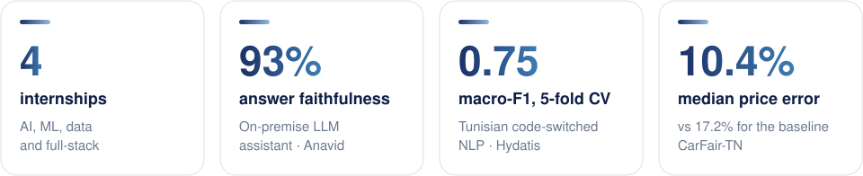
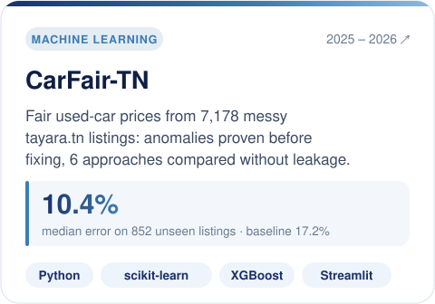
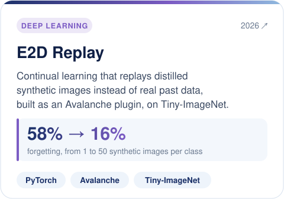
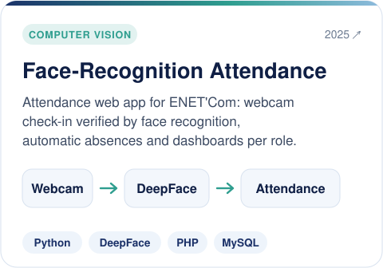
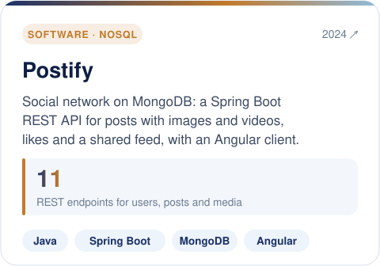

<!-- Add once the site is live:  -->

## 👋 About me

I build AI that holds up on real data, and I prove it with numbers.

Across four internships, I've shipped an **on-premise LLM assistant** that answers business questions from a company's own data warehouse, **fine-tuned transformers** on Tunisian code-switched social media, and built the **warehouses, ETL pipelines and APIs** behind business dashboards. I care about the unglamorous part as much as the model: clean data, leakage-free evaluation, and results someone can check.

🎓 Final year of **Data Engineering & Decision Systems** at ENET'Com, ranked 1st in my class 
🎯 Looking for a **4 to 6 month PFE internship from February 2027**, where I can own an AI or data problem end to end

<picture>
  <source media="(prefers-color-scheme: dark)" srcset="assets/impact-dark.svg" />
  
</picture>

## 💼 Experience

🧠 **Hydatis** · AI/NLP Intern · *Aug – Sep 2026* 
Built a sentiment pipeline for Tunisian code-switched posts: benchmarked 6 transformers, fine-tuned mDeBERTa-v3 to **0.75 macro-F1** (5-fold CV), and delivered the analytics dashboard with an LLM summary written only from computed KPIs.

🤖 **Anavid** · AI & ML Engineer Intern · *Jun – Jul 2026* 
Designed an on-premise LLM assistant with tool calling and RAG over the data warehouse, rated **93% faithful** by an independent LLM judge, and shipped XGBoost visitor forecasting behind FastAPI with daily reports automated in n8n.

🗄️ **Acteol** · Data Engineer Intern · *Jun 2025* 
Designed a snowflake-schema warehouse in SQL Server fed by SSIS, exposed through a .NET API with 10+ endpoints to an Angular purchasing dashboard.

💻 **Prestacode** · Full-Stack Developer Intern · *2023, 2024* 
Built two internal web apps on Spring Boot, PostgreSQL and Angular: an accounting-firm platform with automated billing and role-based access, and a training-session manager.

Internship code belongs to the companies and is not public.

## 🚀 Featured projects

<table>
  <tr>
    <td width="50%">
      <a href="https://github.com/abdelhedy/CarFair-TN"><picture><source media="(prefers-color-scheme: dark)" srcset="assets/card-carfair-dark.svg" /></picture></a>
      
<a href="https://github.com/abdelhedy/CarFair-TN">Code</a> · <a href="https://carfair-tn.streamlit.app/">Live demo</a>

    </td>
    <td width="50%">
      <a href="https://github.com/abdelhedy/e2d-replay-tiny-imagenet"><picture><source media="(prefers-color-scheme: dark)" srcset="assets/card-e2d-dark.svg" /></picture></a>
      
<a href="https://github.com/abdelhedy/e2d-replay-tiny-imagenet">Code</a>

    </td>
  </tr>
  <tr>
    <td width="50%">
      <a href="https://github.com/abdelhedy/presence-management-system"><picture><source media="(prefers-color-scheme: dark)" srcset="assets/card-face-dark.svg" /></picture></a>
      
<a href="https://github.com/abdelhedy/presence-management-system">Code</a>

    </td>
    <td width="50%">
      <a href="https://github.com/abdelhedy/mini-social-media-app"><picture><source media="(prefers-color-scheme: dark)" srcset="assets/card-postify-dark.svg" /></picture></a>
      
<a href="https://github.com/abdelhedy/mini-social-media-app">Back end</a> · <a href="https://github.com/MariemAbdennadher11/postify_material">Front end</a>

    </td>
  </tr>
</table>

## 🛠️ Toolbox

<table>
  <tr>
    <td align="center" width="140"><b>AI & ML</b></td>
    <td> Transformers · XGBoost · Ollama · tool calling · RAG · LLM-as-judge</td>
  </tr>
  <tr>
    <td align="center"><b>Data</b></td>
    <td> SQL Server · SSIS · Power BI · Hadoop · Hive · n8n</td>
  </tr>
  <tr>
    <td align="center"><b>Engineering</b></td>
    <td></td>
  </tr>
</table>

## 🏆 Highlights

- 🥇 Ranked **1st in my class** at ENET'Com (2025–2026)
- 🎤 **Pitching team, Enactus ENET'Com** (2025–2026): pitched two water-saving projects to an international jury
- 📣 Former **Communication Lead, Enactus FSEG Sfax** (2021–2022)
- 📜 CDOSS certifications: [Big Data in Hadoop](https://cdoss.org/abdelhedi-yasmine/) · [Hadoop Administration](https://cdoss.org/yasmine-abdelhedi/) · [Big Data Analytics with Hive](https://cdoss.org/yasmine-abdelhedi-3/) · [AI & ML Fundamentals](https://cdoss.org/yasmine-abdelhedi-2/)

<picture>
  <source media="(prefers-color-scheme: dark)" srcset="https://raw.githubusercontent.com/abdelhedy/abdelhedy/output/snake-dark.svg" />
  
</picture>

Business Information Systems → Data Science → Data Engineering. <i>Started in development, stayed for the data.</i>

